# 🏭 Morning Meeting Dashboard — Production Setup Plan

> **Goal:** Abhi app laptop ke `localhost:5180` par chal raha hai. Is plan ke saath hum ise **company server** par
> ek **professional, structured, auto-deploy hone wale system** mein badlenge — jaise ek Senior Software
> Developer ka banaya hua project dikhta hai.

| | |
|---|---|
| **Document version** | 1.0 |
| **Date** | 21 Oct 2026 |
| **Current stack** | React 18 + Vite 6 + TypeScript + Tailwind 4 (frontend) · Express 5 + Node 24 (backend) · SQLite / better-sqlite3 (database) · vite-plugin-pwa (mobile) |
| **Target** | Company server + HTTPS + GitHub Actions CI/CD + installable mobile app (PWA) |

> 🖼️ **Diagrams kaise dekhein:** Is file mein diagrams **Mermaid** format mein hain.
> - **GitHub** par ye apne-aap image ki tarah dikhenge.
> - **VS Code** mein dekhne ke liye extension install karein: **"Markdown Preview Mermaid Support"** (`bierner.markdown-mermaid`), phir `Ctrl + Shift + V` dabayein.

---

## 📑 Table of Contents

1. [Abhi project ki halat (Current State Audit)](#1--abhi-project-ki-halat-current-state-audit)
2. [Final Architecture (Big Picture)](#2--final-architecture-big-picture)
3. [Naya Folder Structure](#3--naya-folder-structure)
4. [Phase 0 — Taiyari & Cleanup](#phase-0--taiyari--cleanup)
5. [Phase 1 — Frontend Restructure](#phase-1--frontend-restructure)
6. [Phase 2 — Backend Restructure](#phase-2--backend-restructure)
7. [Phase 3 — Database](#phase-3--database)
8. [Phase 4 — OTP Authentication (Login / Register)](#phase-4--otp-authentication-login--register)
9. [Phase 5 — Bug Handling, Error Pages & 404](#phase-5--bug-handling-error-pages--404)
10. [Phase 6 — Company Server Setup](#phase-6--company-server-setup)
11. [Phase 7 — CDN & Caching](#phase-7--cdn--caching)
12. [Phase 8 — DevOps: Git, GitHub & CI/CD Auto-Deploy](#phase-8--devops-git-github--cicd-auto-deploy)
13. [Phase 9 — Mobile App (PWA)](#phase-9--mobile-app-pwa)
14. [Phase 10 — Monitoring, Backups & Go-Live](#phase-10--monitoring-backups--go-live)
15. [Timeline](#-timeline)
16. [IT Team se kya poochna hai](#-it-team-se-kya-poochna-hai-checklist)
17. [Master Checklist](#-master-checklist)

---

## 1. 🔍 Abhi project ki halat (Current State Audit)

Project ko padh kar ye mila — kya achha hai aur kya theek karna hai:

### ✅ Jo pehle se achha hai (isko rakhenge)

| Cheez | Kahan | Note |
|---|---|---|
| React + TypeScript + Vite | `src/` | Modern stack, badalne ki zaroorat nahi |
| Express 5 backend | `server/index.mjs` | Kaam karta hai |
| SQLite database (WAL mode) | `server/database.mjs` | Is size (~16 MB) ke liye perfect |
| Email OTP + Authenticator (TOTP) login | `server/auth.mjs`, `server/totp.mjs` | Base ready hai, sirf harden karna hai |
| Role-based access (user / qa / admin) | `server/access.mjs` | ✔ |
| Audit log (kisne kya kiya) | `server/audit.mjs` | ✔ |
| PWA (installable app) | `vite.config.ts` | Config ready, sirf HTTPS chahiye |
| Gzip compression, SSE live sync | `server/index.mjs` | ✔ |
| Backup / restore scripts | `server/backup-sqlite.mjs` etc. | ✔ |
| Tests | `server/database.test.mjs` | Achhi shuruaat |

### ⚠️ Jo theek karna hai

| # | Problem | Kyon zaroori hai | Phase |
|---|---|---|---|
| 1 | `git` command laptop par install / PATH mein nahi hai | CI/CD ke bina auto-deploy nahi hoga | 0 |
| 2 | `README.md` kisi **dusre project** (PLC Delta DVP) ka hai | Professional nahi lagta | 0 |
| 3 | Root mein faltu files: `Application 1.gif`, `mixkit-musical-reveal-961.wav`, `server-restart.log`, `*.tsbuildinfo`, `vite.config.d.ts` | Unstructured lagta hai | 0 |
| 4 | `Assembly/`, `QA/` mein **company ki real Excel files** | Company data GitHub par nahi jaana chahiye | 0 |
| 5 | `server/index.mjs` ek hi file mein **~1,140 lines** | Maintain karna mushkil | 2 |
| 6 | `src/components/` mein ~80 files ek hi folder mein | Feature-wise folders chahiye | 1 |
| 7 | Frontend mein **router nahi** hai → koi 404 page nahi | Galat URL par blank/confusing | 5 |
| 8 | Backend `/api/xyz` galat route par sirf khaali 404 deta hai | Error JSON hona chahiye | 5 |
| 9 | Central **error handler / logging** nahi hai | Bug pakadna mushkil | 5 |
| 10 | OTP `Math.random()` se banta hai aur **memory** mein store hai | Server restart = OTP gaya; security weak | 4 |
| 11 | Email fail hone par OTP **screen par dikh jaata** hai (`devOtp`) | Production mein **security hole** | 4 |
| 12 | Login par **rate limit** nahi | Brute-force attack possible | 4 |
| 13 | App `http://` par chalta hai | **PWA install + notifications sirf HTTPS par chalte hain** | 6 |
| 14 | Server terminal band = app band | Server reboot par auto-start chahiye | 6 |
| 15 | Koi `.env.example`, lint, formatter nahi | Team standard nahi | 0 |

---

## 2. 🗺️ Final Architecture (Big Picture)

### 2.1 System Diagram

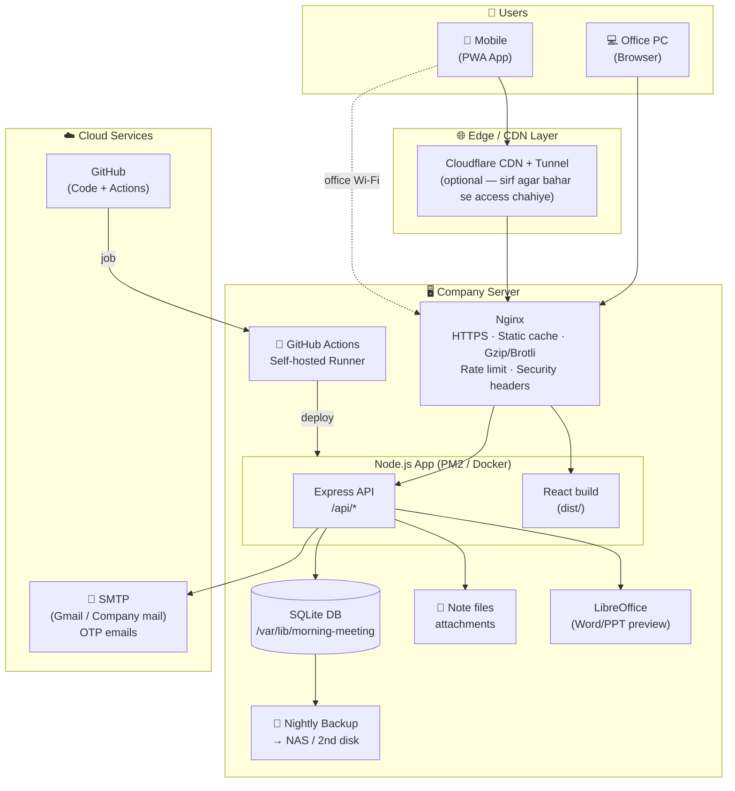

### 2.2 Ek request kaise travel karti hai

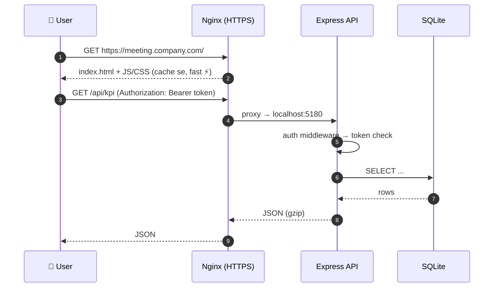

### 2.3 Layer-wise summary

| Layer | Technology | Kaam |
|---|---|---|
| **Frontend** | React 18, Vite, TypeScript, Tailwind, React Router | UI, charts, pages |
| **Backend** | Node 24 LTS, Express 5 | REST API, auth, file handling |
| **Database** | SQLite (better-sqlite3, WAL) | Data storage |
| **CDN / Cache** | Nginx cache + (optional) Cloudflare | Static files fast deliver |
| **Auth** | Email OTP + TOTP (Authenticator) + sessions | Login / Register / Forgot password |
| **DevOps** | Git, GitHub, GitHub Actions (self-hosted runner), PM2 / Docker | Auto test + auto deploy |
| **Error handling** | Error Boundary, 404/500/403/Offline pages, pino logger | Bugs pakadna + user ko saaf message |
| **Mobile** | PWA (vite-plugin-pwa) + optional Android APK (TWA) | Phone par app ki tarah |
| **Monitoring** | Uptime Kuma, logs, `/api/health` | App down ho to turant pata chale |

---

## 3. 📂 Naya Folder Structure

Hum **monorepo** banayenge (npm workspaces) — ek repo, andar `apps/web` (frontend) aur `apps/api` (backend) alag.

### 3.1 Before ➜ After

```
❌ ABHI (Before)                         ✅ BAAD MEIN (After)
─────────────────────────────            ─────────────────────────────
Morning Meeting Application/             morning-meeting/
├── Application 1.gif                    ├── .github/
├── mixkit-musical-reveal-961.wav        ├── apps/
├── server-restart.log                   │   ├── web/        ← Frontend
├── Assembly/  (real Excel data!)        │   └── api/        ← Backend
├── QA/        (real Excel data!)        ├── infra/          ← Server config
├── dist/                                ├── docs/           ← Documentation
├── docs/                                ├── scripts/
├── public/                              ├── .env.example
├── scripts/                             ├── .editorconfig
├── server/   (index.mjs = 1140 lines)   ├── eslint.config.js
├── src/      (80 files ek folder)       ├── package.json    (workspaces)
├── index.html                           ├── PLAN.md
├── package.json                         └── README.md
└── README.md (dusre project ka!)
```

### 3.2 Poora Target Structure (detail)

```
morning-meeting/
│
├── .github/
│   ├── workflows/
│   │   ├── ci.yml                    # Har PR par: lint + typecheck + test + build
│   │   └── deploy.yml                # main par push → company server par deploy
│   ├── ISSUE_TEMPLATE/
│   │   ├── bug_report.md             # Bug report ka format
│   │   └── feature_request.md
│   ├── pull_request_template.md
│   └── CODEOWNERS                    # Kaun review karega
│
├── apps/
│   ├── web/                          # ───────── FRONTEND ─────────
│   │   ├── public/
│   │   │   ├── icons/                # pwa-192x192.png, pwa-512x512.png, maskable, apple-touch-icon
│   │   │   ├── sounds/notify.wav
│   │   │   ├── images/company.jpg
│   │   │   ├── push-sw.js
│   │   │   └── offline.html          # Internet na ho to ye dikhe
│   │   ├── src/
│   │   │   ├── main.tsx              # Entry point
│   │   │   ├── app/
│   │   │   │   ├── App.tsx           # Providers + Router
│   │   │   │   ├── routes.tsx        # Saare routes ek jagah
│   │   │   │   └── ProtectedRoute.tsx# Login / role check
│   │   │   ├── pages/                # Ek URL = ek page
│   │   │   │   ├── DashboardPage.tsx
│   │   │   │   ├── LoginPage.tsx
│   │   │   │   ├── RegisterPage.tsx
│   │   │   │   ├── ForgotPasswordPage.tsx
│   │   │   │   ├── AdminLoginPage.tsx
│   │   │   │   ├── QaPage.tsx
│   │   │   │   ├── SettingsPage.tsx
│   │   │   │   └── errors/
│   │   │   │       ├── NotFoundPage.tsx      # 404
│   │   │   │       ├── ForbiddenPage.tsx     # 403
│   │   │   │       ├── ServerErrorPage.tsx   # 500
│   │   │   │       └── OfflinePage.tsx
│   │   │   ├── features/             # Feature-wise code (components + hooks + logic)
│   │   │   │   ├── auth/             # AuthScreen, AdminAuthScreen, QrCode, auth.ts
│   │   │   │   ├── assembly/         # AssemblyDashboard, AssemblyUploadModal, assembly.ts
│   │   │   │   ├── kpi/              # KpiGrid, KpiPage, KpiTrend*, ProdKpiPage
│   │   │   │   ├── machines/         # MachineTable, MachineDetailModal, MachineCompare...
│   │   │   │   ├── qa/               # QaApp, qa/*
│   │   │   │   ├── pd-report/        # pd/*
│   │   │   │   ├── cpk/              # CpkMatrix, CpkView, cpk.ts
│   │   │   │   ├── maintenance/      # MaintenanceReport*
│   │   │   │   ├── route-card/       # RouteCard*
│   │   │   │   ├── monthly-plan/     # MonthlyPlanning*, MonthlyReportView
│   │   │   │   ├── notes/            # NotesView, AddNoteModal, NoteFileRow
│   │   │   │   ├── notifications/    # notify/*
│   │   │   │   ├── meetings/         # MeetingHistory, SaveMeetingModal
│   │   │   │   ├── backup/           # BackupView, BackupCleanModal
│   │   │   │   └── admin/            # UserAccessModal, UserHistoryPanel, StorageModal
│   │   │   ├── components/           # Sirf SHARED / reusable UI
│   │   │   │   ├── ui/               # SelectMenu, DateRangePicker, MonthRangePicker, Modal, Button
│   │   │   │   ├── charts/           # ChartTooltip, EfficiencyChart, ...
│   │   │   │   ├── layout/           # Sidebar, MobileNav, Header
│   │   │   │   └── ErrorBoundary.tsx
│   │   │   ├── services/
│   │   │   │   └── api.ts            # Ek hi fetch wrapper (token, errors, retry)
│   │   │   ├── hooks/                # useAuth, useOnlineStatus, ...
│   │   │   ├── lib/                  # Pure helper functions (aggregate, chartFit, i18n...)
│   │   │   ├── types/                # types.ts
│   │   │   └── styles/index.css
│   │   ├── index.html
│   │   ├── vite.config.ts
│   │   ├── tsconfig.json
│   │   └── package.json
│   │
│   └── api/                          # ───────── BACKEND ─────────
│       ├── src/
│       │   ├── server.mjs            # Sirf app.listen() + graceful shutdown
│       │   ├── app.mjs               # Express app banata hai (middlewares + routes)
│       │   ├── config/
│       │   │   └── env.mjs           # .env padhna + validate (missing ho to start hi na ho)
│       │   ├── middleware/
│       │   │   ├── requireAuth.mjs
│       │   │   ├── requireRole.mjs
│       │   │   ├── rateLimit.mjs
│       │   │   ├── gzip.mjs
│       │   │   ├── requestId.mjs     # Har request ko ek ID (logs trace karne ke liye)
│       │   │   ├── notFound.mjs      # API 404 JSON
│       │   │   └── errorHandler.mjs  # Central error handler
│       │   ├── modules/              # Har feature = routes + service + repository
│       │   │   ├── auth/
│       │   │   │   ├── auth.routes.mjs
│       │   │   │   ├── auth.service.mjs
│       │   │   │   ├── otp.service.mjs
│       │   │   │   └── totp.mjs
│       │   │   ├── datasets/         # /api/<name> generic collections
│       │   │   ├── qa/
│       │   │   ├── notes/            # notes + files + office preview
│       │   │   ├── admin/            # users, access, history, storage
│       │   │   ├── events/           # SSE /api/events
│       │   │   ├── backup/           # backupClean
│       │   │   └── health/           # /api/health
│       │   ├── db/
│       │   │   ├── database.mjs
│       │   │   └── migrations/
│       │   │       ├── 001_initial.sql
│       │   │       └── 002_otp_codes.sql
│       │   ├── services/
│       │   │   ├── mailer.mjs
│       │   │   ├── officePreview.mjs # LibreOffice wala code
│       │   │   └── audit.mjs
│       │   └── utils/
│       │       ├── logger.mjs        # pino logger
│       │       └── AppError.mjs      # Custom error class
│       ├── scripts/                  # backup, restore, migrate, benchmark
│       ├── test/                     # *.test.mjs
│       └── package.json
│
├── infra/                            # ───────── SERVER / DEVOPS ─────────
│   ├── nginx/
│   │   └── morning-meeting.conf
│   ├── pm2/
│   │   └── ecosystem.config.cjs
│   ├── docker/                       # (Option B — agar Docker use karein)
│   │   ├── Dockerfile
│   │   └── docker-compose.yml
│   └── scripts/
│       ├── deploy.sh                 # Build → backup → restart → health check → rollback
│       ├── backup.sh                 # Nightly cron
│       └── setup-server.sh           # Naye server ki one-time setup
│
├── docs/
│   ├── ARCHITECTURE.md
│   ├── DEPLOYMENT.md                 # Server par deploy kaise karein
│   ├── RUNBOOK.md                    # "App down hai to kya karein"
│   ├── API.md                        # Saare endpoints ki list
│   ├── USER-GUIDE.md                 # HOW-TO-START.md ka naya version
│   └── adr/                          # Architecture Decision Records (kyon ye choose kiya)
│       └── 001-keep-sqlite.md
│
├── .editorconfig
├── .env.example                      # Saari env keys (bina values ke) — commit hota hai
├── .gitignore
├── .nvmrc                            # "24"
├── .prettierrc
├── eslint.config.js
├── package.json                      # npm workspaces root
├── CHANGELOG.md
├── PLAN.md
└── README.md
```

### 3.3 Naming Rules (team standard)

| Cheez | Rule | Example |
|---|---|---|
| React component | `PascalCase.tsx` | `MachineTable.tsx` |
| Hook | `useCamelCase.ts` | `useAuth.ts` |
| Helper / lib | `camelCase.ts` | `chartFit.ts` |
| Backend module | `feature.layer.mjs` | `auth.routes.mjs`, `auth.service.mjs` |
| Folder | `kebab-case` | `route-card/`, `pd-report/` |
| Env variable | `UPPER_SNAKE_CASE` | `SMTP_HOST` |
| Git branch | `type/short-name` | `feature/otp-rate-limit`, `fix/kpi-chart-crash` |
| Commit | Conventional Commits | `feat(auth): add OTP rate limiting` |

---

## Phase 0 — Taiyari & Cleanup

**⏱ 1–2 din** · **Goal:** Project ko saaf karna aur Git/GitHub ready karna.

### 0.1 Tools install karo (laptop par)

| Tool | Kyon | Download |
|---|---|---|
| **Git for Windows** | Abhi `git` command kaam nahi kar raha | git-scm.com |
| **GitHub Desktop** (optional) | GUI se commit/push aasaan | desktop.github.com |
| **Node.js 24 LTS** | Already installed (`v24.20.0`) ✔ | — |

Install ke baad check karo:

```powershell
git --version
git config --global user.name  "Nikhil Rana"
git config --global user.email "nikhilrana21422@gmail.com"
```

### 0.2 Sensitive / faltu files hatao

```powershell
# Ye files repo se bahar ya sahi jagah jaayengi
Application 1.gif               → docs/images/demo.gif  (README mein use karo)
mixkit-musical-reveal-961.wav   → apps/web/public/sounds/ (agar use hota hai) warna delete
server-restart.log              → delete (logs git mein nahi jaate)
*.tsbuildinfo, vite.config.d.ts → delete + .gitignore mein daalo
Assembly/*.xlsx, QA/*.xlsx      → company data — repo se HATAO, sirf ek dummy sample rakho
server/data/lo-profile/         → LibreOffice ka cache — gitignore (already server/data ignored ✔)
```

> ⚠️ **Important:** Agar `Assembly/` ya `QA/` ki Excel files pehle hi kisi commit mein chali gayi hain,
> to sirf delete karna kaafi nahi — wo Git history mein rahengi. GitHub par push karne se **pehle**
> naya clean repo banana better hai (ya `git filter-repo` use karein).

### 0.3 Naya `.gitignore`

```gitignore
# dependencies & builds
node_modules/
dist/
dist-ssr/
*.tsbuildinfo
vite.config.d.ts

# runtime data — kabhi commit nahi
apps/api/data/
server/data/
**/sqlite-backups/
**/data-migration-backups/
*.db
*.db-shm
*.db-wal

# secrets
.env
.env.*
!.env.example

# logs
logs/
*.log

# company files
Assembly/
QA/

# OS / editor
.DS_Store
Thumbs.db
.vscode/*
!.vscode/extensions.json
```

### 0.4 `.env.example` (commit hota hai — values khaali)

```ini
# ── App ──
NODE_ENV=production
PORT=5180
APP_URL=https://meeting.company.com
MM_DATA_DIR=/var/lib/morning-meeting/data
LOG_LEVEL=info

# ── Email (OTP) ──
SMTP_HOST=smtp.gmail.com
SMTP_PORT=465
SMTP_USER=
SMTP_PASS=            # Gmail App Password / company SMTP password
MAIL_FROM="Morning Meeting <no-reply@company.com>"

# ── Security ──
OTP_TTL_MINUTES=5
OTP_MAX_ATTEMPTS=5
MAX_SESSIONS_PER_USER=3
```

> Abhi code `GMAIL_USER` / `GMAIL_PASS` padhta hai (`server/mailer.mjs`). Phase 2 mein `config/env.mjs`
> banake inko `SMTP_*` mein rename karenge (purane naam bhi kuch time support karenge).

### 0.5 Code quality tools

```powershell
npm i -D eslint @eslint/js typescript-eslint eslint-plugin-react-hooks prettier
```

`package.json` (root) scripts:

```json
{
  "scripts": {
    "dev":        "npm run dev --workspaces --if-present",
    "build":      "npm run build -w apps/web",
    "lint":       "eslint .",
    "format":     "prettier --write .",
    "typecheck":  "tsc -b apps/web",
    "test":       "npm test -w apps/api",
    "start":      "node apps/api/src/server.mjs"
  },
  "workspaces": ["apps/*"]
}
```

### 0.6 Naya README.md

Purana README (PLC Delta wala) hata kar naya likho jisme ho:

1. Project kya karta hai (1 para + screenshot/GIF)
2. Tech stack badges
3. Local setup (`npm ci` → `npm run dev`)
4. Folder structure (short)
5. Environment variables (link to `.env.example`)
6. Deployment (link to `docs/DEPLOYMENT.md`)
7. Scripts table

### ✅ Phase 0 Done jab:
- [ ] `git --version` chalta hai
- [ ] Faltu files hat gayi, company data repo mein nahi hai
- [ ] `.gitignore`, `.env.example`, `.editorconfig`, `.prettierrc`, `eslint.config.js` ready
- [ ] Naya README

---

## Phase 1 — Frontend Restructure

**⏱ 3–4 din** · **Goal:** `src/components/` ke 80 files ko feature-wise organise karna + routing.

### 1.1 Steps (is order mein karo — har step ke baad app chala ke check karo)

1. `apps/web/` folder banao; `src/`, `public/`, `index.html`, `vite.config.ts`, `tsconfig*.json` wahan move karo.
2. `features/` folders banao aur components move karo (table neeche).
3. Shared cheezein `components/ui`, `components/layout`, `components/charts` mein.
4. Har jagah imports fix karo — **VS Code** file move karne par imports khud update karne ka offer karta hai ("Update imports" → Yes).
5. `tsconfig.json` mein path alias add karo taaki `../../../` na likhna pade:

```jsonc
// apps/web/tsconfig.json
{
  "compilerOptions": {
    "baseUrl": ".",
    "paths": { "@/*": ["src/*"] }
  }
}
```

```ts
// apps/web/vite.config.ts
import path from 'path'
export default defineConfig({
  resolve: { alias: { '@': path.resolve(__dirname, 'src') } },
  // ...baaki config same
})
```

Ab import aisa dikhega: `import { MachineTable } from '@/features/machines/MachineTable'`

### 1.2 Component → Folder mapping

| Current file(s) | New folder |
|---|---|
| `auth/AuthScreen`, `auth/AdminAuthScreen`, `auth/QrCode`, `lib/auth.ts` | `features/auth/` |
| `AssemblyDashboard`, `AssemblyUploadModal`, `lib/assembly.ts` | `features/assembly/` |
| `KpiGrid`, `KpiPage`, `KpiTrendView`, `KpiTrendDetail`, `KpiBreakdownModal`, `ProdKpiPage` | `features/kpi/` |
| `MachineTable`, `MachineDetailModal`, `MachineCompareModal`, `MachineRangeModal` | `features/machines/` |
| `QaApp`, `qa/*` | `features/qa/` |
| `pd/*` | `features/pd-report/` |
| `CpkMatrix`, `CpkView`, `lib/cpk.ts` | `features/cpk/` |
| `MaintenanceReport*`, `lib/maintenanceReport.ts` | `features/maintenance/` |
| `RouteCard*` | `features/route-card/` |
| `MonthlyPlanningView`, `MonthlyPlanUploadModal`, `MonthlyReportView` | `features/monthly-plan/` |
| `NotesView`, `AddNoteModal`, `NoteFileRow`, `FilePreviewModal` | `features/notes/` |
| `notify/*`, `lib/alarm.ts` | `features/notifications/` |
| `MeetingHistory`, `SaveMeetingModal`, `lib/history.ts` | `features/meetings/` |
| `BackupView`, `BackupCleanModal`, `lib/backup*.ts` | `features/backup/` |
| `UserAccessModal`, `UserHistoryPanel`, `StorageModal`, `lib/access.ts` | `features/admin/` |
| `Upload*`, `ImportModal` | `features/upload/` |
| `Sidebar`, `MobileNav`, `LoopBar` | `components/layout/` |
| `SelectMenu`, `DateRangePicker`, `MonthRangePicker`, `HScrollButtons` | `components/ui/` |
| `charts/*` | `components/charts/` |

### 1.3 Routing add karo (React Router)

Abhi app `window.location.hash` aur state se screens badalta hai. Proper URLs ke liye:

```powershell
npm i react-router-dom -w apps/web
```

```tsx
// apps/web/src/app/routes.tsx
import { createBrowserRouter } from 'react-router-dom'

export const router = createBrowserRouter([
  { path: '/login',           element: <LoginPage /> },
  { path: '/register',        element: <RegisterPage /> },
  { path: '/forgot-password', element: <ForgotPasswordPage /> },
  { path: '/admin/login',     element: <AdminLoginPage /> },
  {
    element: <ProtectedRoute />,            // login nahi → /login
    errorElement: <ServerErrorPage />,      // page crash → 500 page
    children: [
      { path: '/',            element: <DashboardPage /> },
      { path: '/kpi',         element: <KpiPage /> },
      { path: '/qa',          element: <ProtectedRoute role="qa" />, children: [{ index: true, element: <QaPage /> }] },
      { path: '/settings',    element: <SettingsPage /> },
      { path: '/admin/*',     element: <ProtectedRoute role="admin" />, children: [/* ... */] },
    ],
  },
  { path: '/403', element: <ForbiddenPage /> },
  { path: '*',    element: <NotFoundPage /> },   // ← 404
])
```

```mermaid
flowchart LR
    A[User opens URL] --> B{Route match?}
    B -- No --> NF[404 NotFoundPage]
    B -- Yes --> C{Login hai?}
    C -- No --> L[/login]
    C -- Yes --> D{Role allowed?}
    D -- No --> F[403 ForbiddenPage]
    D -- Yes --> P[Page render]
    P --> E{Crash?}
    E -- Yes --> S[500 ServerErrorPage]
    E -- No --> OK[✅ Page dikhta hai]
```

> Note: `vite.config.ts` mein `base: './'` hai. Browser routes (`/kpi`) ke saath `base: '/'` karna padega,
> warna nested URL refresh par JS file nahi milegi. (Tauri/Capacitor ki zaroorat ho to `createHashRouter` use karo.)

### 1.4 Ek API client

Har component apna `fetch` likhne ki jagah ek `services/api.ts`:

```ts
// apps/web/src/services/api.ts
export class ApiError extends Error {
  constructor(public status: number, message: string) { super(message) }
}

export async function api<T>(path: string, init: RequestInit = {}): Promise<T> {
  const token = localStorage.getItem('mm_token')
  const res = await fetch(`/api${path}`, {
    ...init,
    headers: {
      'Content-Type': 'application/json',
      ...(token ? { Authorization: `Bearer ${token}` } : {}),
      ...init.headers,
    },
  })
  if (res.status === 401) { window.location.href = '/login'; throw new ApiError(401, 'Session expired') }
  if (!res.ok) {
    const body = await res.json().catch(() => ({}))
    throw new ApiError(res.status, body.error || 'Something went wrong')
  }
  return res.json()
}
```

### ✅ Phase 1 Done jab:
- [ ] `apps/web` se `npm run dev` chalta hai, sab screens kaam karti hain
- [ ] Har feature apne folder mein
- [ ] React Router laga hai, har screen ka apna URL hai
- [ ] `npm run build` bina error

---

## Phase 2 — Backend Restructure

**⏱ 3–4 din** · **Goal:** 1,140 line ki `index.mjs` ko modules mein todna + config/logging/security.

### 2.1 Layered architecture

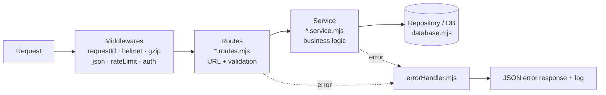

| Layer | Kya karta hai | Kya NAHI karta |
|---|---|---|
| **Routes** | URL, request validate, response bhejna | SQL nahi likhta |
| **Service** | Business rules (e.g. "admin hi user delete kar sakta hai") | `req`/`res` nahi chhoota |
| **Repository/DB** | SQL queries | Business logic nahi |

### 2.2 `index.mjs` ko kaise todna hai

| `index.mjs` mein abhi (line approx.) | Naya file |
|---|---|
| `.env` loading, `DATA_DIR` (1–36) | `config/env.mjs` |
| Gzip middleware (51–75) | `middleware/gzip.mjs` |
| `/api/${name}` generic collections (~195–240) | `modules/datasets/datasets.routes.mjs` |
| `/api/qa*` (~357–395) | `modules/qa/qa.routes.mjs` |
| `/api/notes/files*` (~463–700) | `modules/notes/notes.routes.mjs` |
| LibreOffice `findSoffice` (~545–655) | `services/officePreview.mjs` |
| `/api/health` (715) | `modules/health/health.routes.mjs` |
| `/api/events` SSE (742) | `modules/events/events.routes.mjs` |
| `/api/admin/*` (779–1100) | `modules/admin/admin.routes.mjs` |
| Static + SPA fallback (1113–1128) | `app.mjs` (end) |
| `app.listen` (1130+) | `server.mjs` |

### 2.3 `app.mjs` aur `server.mjs`

```js
// apps/api/src/app.mjs
import express from 'express'
import helmet from 'helmet'
import { config } from './config/env.mjs'
import { requestId } from './middleware/requestId.mjs'
import { gzipJson } from './middleware/gzip.mjs'
import { notFoundApi } from './middleware/notFound.mjs'
import { errorHandler } from './middleware/errorHandler.mjs'
import { authRoutes } from './modules/auth/auth.routes.mjs'
// ... baaki modules

export function createApp({ database }) {
  const app = express()
  app.set('trust proxy', 1)                 // Nginx ke peeche real IP ke liye
  app.use(requestId)
  app.use(helmet({ contentSecurityPolicy: false })) // CSP baad mein tune karenge
  app.use(gzipJson)
  app.use(express.json({ limit: '32mb' }))

  app.use('/api/auth',  authRoutes({ database }))
  app.use('/api/qa',    qaRoutes({ database }))
  app.use('/api/notes', notesRoutes({ database }))
  app.use('/api/admin', adminRoutes({ database }))
  app.use('/api',       healthRoutes({ database }))

  app.use('/api', notFoundApi)              // ← API 404 JSON
  serveSpa(app, config.distDir)             // ← React app + SPA fallback
  app.use(errorHandler)                     // ← hamesha LAST
  return app
}
```

```js
// apps/api/src/server.mjs
import { createApp } from './app.mjs'
import { openDatabase } from './db/database.mjs'
import { config } from './config/env.mjs'
import { logger } from './utils/logger.mjs'

const database = openDatabase(config.dataDir)
const app = createApp({ database })
const server = app.listen(config.port, '127.0.0.1', () =>   // sirf Nginx se access
  logger.info(`API listening on :${config.port}`))

// Graceful shutdown — deploy ke time DB corrupt na ho
for (const sig of ['SIGINT', 'SIGTERM']) {
  process.on(sig, () => {
    logger.info(`${sig} received, shutting down`)
    server.close(() => { database.close(); process.exit(0) })
    setTimeout(() => process.exit(1), 10_000).unref()
  })
}
process.on('unhandledRejection', (err) => logger.error({ err }, 'unhandledRejection'))
process.on('uncaughtException',  (err) => { logger.fatal({ err }, 'uncaughtException'); process.exit(1) })
```

> 💡 Listen `'0.0.0.0'` ki jagah `'127.0.0.1'` — ab bahar se seedha port 5180 nahi khulega,
> sab traffic Nginx (HTTPS) se hi aayega.

### 2.4 Config validation

```js
// apps/api/src/config/env.mjs
import path from 'path'
try { process.loadEnvFile() } catch {}

const required = (key) => {
  const v = process.env[key]
  if (!v) throw new Error(`❌ Missing env variable: ${key} — check .env`)
  return v
}
const isProd = process.env.NODE_ENV === 'production'

export const config = Object.freeze({
  isProd,
  port:     Number(process.env.PORT || 5180),
  appUrl:   process.env.APP_URL || 'http://localhost:5180',
  dataDir:  path.resolve(process.env.MM_DATA_DIR || 'data'),
  distDir:  path.resolve(process.env.DIST_DIR || '../web/dist'),
  smtp: {
    host: process.env.SMTP_HOST || 'smtp.gmail.com',
    port: Number(process.env.SMTP_PORT || 465),
    user: isProd ? required('SMTP_USER') : process.env.SMTP_USER || process.env.GMAIL_USER,
    pass: isProd ? required('SMTP_PASS') : process.env.SMTP_PASS || process.env.GMAIL_PASS,
  },
})
```

### 2.5 Logging (pino)

```powershell
npm i pino pino-http -w apps/api
npm i -D pino-pretty -w apps/api
```

- Development: rangeen readable logs (`pino-pretty`)
- Production: JSON logs → file (`/var/log/morning-meeting/app.log`) — PM2/logrotate rotate karega
- **Kabhi log mat karo:** passwords, OTP, tokens, SMTP password

### 2.6 New dependencies (backend)

| Package | Kaam |
|---|---|
| `helmet` | Security headers |
| `express-rate-limit` | Brute force rokna |
| `pino`, `pino-http` | Logging |
| `zod` | Request body validation |

### ✅ Phase 2 Done jab:
- [ ] `index.mjs` khatam; `server.mjs` < 40 lines
- [ ] Har module apne folder mein, tests pass (`npm test`)
- [ ] Env missing ho to app clear error ke saath band ho
- [ ] Logs file mein aa rahe hain

---

## Phase 3 — Database

**⏱ 2 din** · **Goal:** SQLite ko production-ready banana: sahi location, migrations, backups.

### 3.1 Decision: SQLite hi rakhenge ✅ (PostgreSQL abhi nahi)

| Factor | SQLite | PostgreSQL |
|---|---|---|
| Current data size (~16 MB) | ✅ Bahut aaram se | Overkill |
| Users (ek plant, dozens) | ✅ WAL mode mein theek | ✅ |
| Setup / maintenance | ✅ Zero (ek file) | Alag server, users, tuning |
| Backup | ✅ Ek file copy | `pg_dump` setup |
| Ek se zyada app servers | ❌ | ✅ |
| Code change | ✅ Kuch nahi | Bahut (better-sqlite3 → pg, sync → async) |

**Kab PostgreSQL par jaana hai:** jab (a) app ko 2+ servers par chalana ho (load balancing), ya
(b) DB size kai GB ho jaaye, ya (c) bahut saare log ek saath likh rahe hon aur "database is locked" errors aane lagein.
Ye decision `docs/adr/001-keep-sqlite.md` mein likh do.

### 3.2 Data location (server par)

```
/var/lib/morning-meeting/
├── data/
│   ├── morning-meeting.db        # main DB
│   ├── morning-meeting.db-wal
│   ├── morning-meeting.db-shm
│   ├── note-files/               # attachments
│   └── archive/
└── backups/
    ├── daily/    (7 rakho)
    ├── weekly/   (4 rakho)
    └── monthly/  (6 rakho)
```

Code already `MM_DATA_DIR` env support karta hai ✔ — bas `.env` mein set karna hai.
**Data kabhi code folder ke andar nahi** — taaki deploy/`git clean` se data delete na ho.

### 3.3 Schema Migrations

Har DB change ek numbered SQL file — server start hote hi pending migrations chal jaayein:

```
db/migrations/
├── 001_initial.sql        # current schema
├── 002_otp_codes.sql      # Phase 4 ka naya table
└── 003_....sql
```

```js
// db/migrate.mjs (idea)
db.exec(`CREATE TABLE IF NOT EXISTS schema_migrations (version TEXT PRIMARY KEY, applied_at INTEGER)`)
const done = new Set(db.prepare('SELECT version FROM schema_migrations').pluck().all())
for (const file of fs.readdirSync(dir).sort()) {
  if (done.has(file)) continue
  db.transaction(() => {
    db.exec(fs.readFileSync(path.join(dir, file), 'utf8'))
    db.prepare('INSERT INTO schema_migrations VALUES (?, ?)').run(file, Date.now())
  })()
  logger.info(`Migration applied: ${file}`)
}
```

**Rule:** Ek baar deploy hui migration file ko **kabhi edit mat karo** — naya number banao.

### 3.4 Laptop se Server par data shift karna (one time)

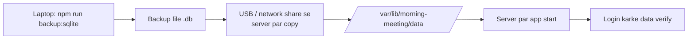

> ⚠️ Running app ki `.db` file seedha copy **mat** karo (WAL ki wajah se adhoora data aa sakta hai).
> Hamesha `npm run backup:sqlite` (ya app band karke) copy karo.

### 3.5 Backups

| Kya | Kab | Kahan | Kitne rakhne |
|---|---|---|---|
| Full DB + note-files | Roz raat 2:00 baje | 2nd disk / NAS / network share | 7 daily, 4 weekly, 6 monthly |
| Deploy se pehle | Har deploy | `backups/pre-deploy/` | Last 5 |
| **Restore test** | Har mahine | Test folder | — |

```bash
# /etc/cron.d/morning-meeting-backup   (Linux)
0 2 * * *  mmapp  /opt/morning-meeting/infra/scripts/backup.sh >> /var/log/morning-meeting/backup.log 2>&1
```

Windows server par yahi kaam **Task Scheduler** se (`npm run backup:sqlite` daily 2:00 AM).

> 🔑 **Golden rule:** Jo backup kabhi restore karke test nahi kiya, wo backup nahi hai.

### ✅ Phase 3 Done jab:
- [ ] Data `/var/lib/morning-meeting/data` mein
- [ ] Migrations system chal raha hai
- [ ] Nightly backup + ek restore test successful

---

## Phase 4 — OTP Authentication (Login / Register)

**⏱ 2–3 din** · **Goal:** Existing OTP system ko secure aur reliable banana.

### 4.1 Current flows (jo already bane hain)

| Role | Register | Login | Forgot password |
|---|---|---|---|
| **User** | Email OTP | Username + password | Email OTP |
| **QA** | Email OTP | Username + password | Email OTP |
| **Admin** | Authenticator app (TOTP, QR code) | Username + password + TOTP | TOTP |

### 4.2 Register flow (User) — target

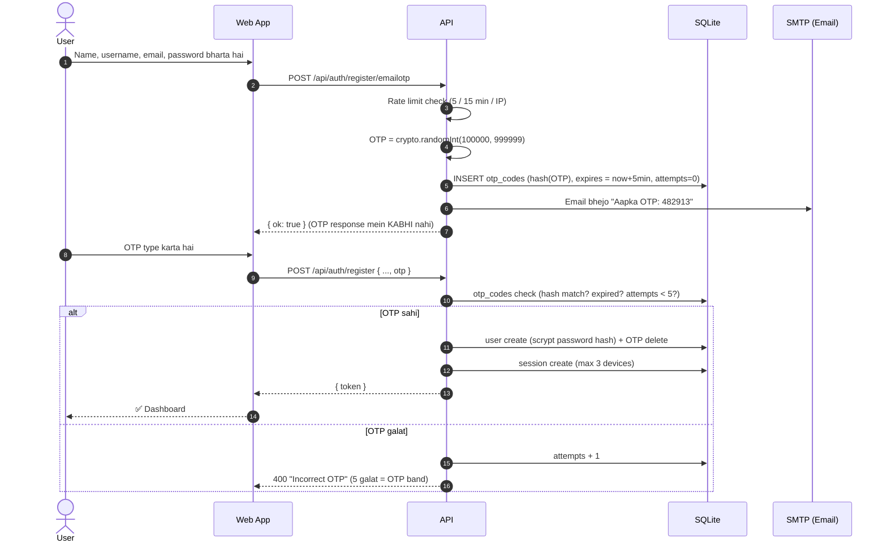

### 4.3 Security fixes (zaroori)

| # | Abhi | Fix |
|---|---|---|
| 1 | `Math.random()` se OTP (`auth.mjs:77`) | `crypto.randomInt(100000, 1000000)` |
| 2 | OTP memory `Map` mein (`auth.mjs:75`) — restart par gayab | SQLite table `otp_codes` mein, **hashed** |
| 3 | Mail fail par OTP response mein (`devOtp`, `auth.mjs:83`) | `NODE_ENV=production` mein **band**; sirf dev mein |
| 4 | OTP par unlimited try | Max 5 attempts, phir naya OTP mangna pade |
| 5 | Login/OTP endpoints par rate limit nahi | `express-rate-limit` |
| 6 | Resend OTP spam | 60 second cooldown |
| 7 | Password policy user = 6 char | Min 8 char recommend |
| 8 | Session tokens kabhi expire nahi? (check karo) | 30 din idle expiry + logout-all-devices |

```sql
-- db/migrations/002_otp_codes.sql
CREATE TABLE IF NOT EXISTS otp_codes (
  key         TEXT PRIMARY KEY,         -- 'reg:username' / 'reset:username'
  code_hash   TEXT NOT NULL,            -- sha256(otp + secret)
  email       TEXT NOT NULL,
  expires_at  INTEGER NOT NULL,
  attempts    INTEGER NOT NULL DEFAULT 0,
  last_sent_at INTEGER NOT NULL
);
```

```js
// middleware/rateLimit.mjs
import rateLimit from 'express-rate-limit'

export const authLimiter = rateLimit({
  windowMs: 15 * 60 * 1000,   // 15 minute
  limit: 10,                  // 10 request per IP
  standardHeaders: 'draft-7',
  legacyHeaders: false,
  message: { error: 'Too many attempts. Please try again after 15 minutes.' },
})

export const otpLimiter = rateLimit({
  windowMs: 15 * 60 * 1000,
  limit: 5,
  message: { error: 'Too many OTP requests. Please wait before trying again.' },
})
```

### 4.4 Email (SMTP) options

| Option | Pros | Cons |
|---|---|---|
| **Gmail + App Password** (abhi wala) | Free, ready | ~500 mail/din limit, "from" personal Gmail |
| **Company SMTP / Microsoft 365** ✅ recommended | `no-reply@company.com` se mail, professional | IT se credentials lene padenge |
| Transactional service (Brevo, SES) | High delivery | External service, cost |

> Email template mein company logo + "Ye OTP 5 minute mein expire hoga. Kisi ko share na karein." likho.

### ✅ Phase 4 Done jab:
- [ ] Table ke saare 8 fixes lag gaye
- [ ] Test: galat OTP 5 baar → block; expired OTP → reject; server restart ke baad bhi OTP valid
- [ ] Production mein OTP kabhi screen par nahi dikhta

---

## Phase 5 — Bug Handling, Error Pages & 404

**⏱ 2–3 din** · **Goal:** Kuch bhi galat ho — user ko saaf page dikhe, developer ko log mein poori detail mile.

### 5.1 Error Pages ki list

| Code | Page | Kab dikhega | Button |
|---|---|---|---|
| **404** | Not Found | Galat URL | "Go to Dashboard" |
| **403** | Forbidden | Role allowed nahi (e.g. user ne `/admin` khola) | "Go Back" |
| **401** | → Login redirect | Session expire | auto redirect |
| **500** | Something went wrong | React crash / server error | "Reload" + "Report bug" |
| **Offline** | No internet | Network nahi (PWA) | "Retry" |
| **503** | Maintenance | Deploy ke time | auto-refresh |

### 5.2 404 Page design (wireframe)

```
┌──────────────────────────────────────────────────────┐
│  [Company Logo]   Morning Meeting Dashboard           │
├──────────────────────────────────────────────────────┤
│                                                      │
│                      🔍                               │
│                     404                               │
│               Page not found                          │
│                                                      │
│     The page you are looking for doesn't exist       │
│     or has been moved.                               │
│                                                      │
│        [ ← Go to Dashboard ]   [ Go Back ]           │
│                                                      │
│      Requested: /kpi/machine-77                      │
└──────────────────────────────────────────────────────┘
```

```tsx
// apps/web/src/pages/errors/NotFoundPage.tsx
import { Link, useLocation, useNavigate } from 'react-router-dom'
import { SearchX } from 'lucide-react'

export function NotFoundPage() {
  const { pathname } = useLocation()
  const navigate = useNavigate()
  return (
    <main className="min-h-dvh grid place-items-center bg-slate-50 p-6 text-center">
      <div className="max-w-md">
        <SearchX className="mx-auto h-14 w-14 text-indigo-500" aria-hidden />
        <p className="mt-4 text-6xl font-bold text-slate-800">404</p>
        <h1 className="mt-2 text-xl font-semibold text-slate-700">Page not found</h1>
        <p className="mt-2 text-slate-500">The page you are looking for doesn't exist or has been moved.</p>
        <div className="mt-6 flex justify-center gap-3">
          <Link to="/" className="rounded-lg bg-indigo-600 px-4 py-2 text-white">Go to Dashboard</Link>
          <button onClick={() => navigate(-1)} className="rounded-lg border px-4 py-2">Go Back</button>
        </div>
        <p className="mt-6 text-xs text-slate-400">Requested: {pathname}</p>
      </div>
    </main>
  )
}
```

### 5.3 React Error Boundary (crash par white screen nahi)

```tsx
// apps/web/src/components/ErrorBoundary.tsx
import { Component, type ReactNode } from 'react'

export class ErrorBoundary extends Component<{ children: ReactNode }, { error?: Error }> {
  state: { error?: Error } = {}
  static getDerivedStateFromError(error: Error) { return { error } }
  componentDidCatch(error: Error, info: { componentStack?: string | null }) {
    // Server ko bhejo taaki logs mein aaye
    navigator.sendBeacon?.('/api/client-errors', JSON.stringify({
      message: error.message, stack: error.stack, component: info.componentStack, url: location.href,
    }))
  }
  render() {
    if (this.state.error) return <ServerErrorPage onRetry={() => location.reload()} />
    return this.props.children
  }
}
```

### 5.4 Backend: API 404 + central error handler

```js
// middleware/notFound.mjs
export const notFoundApi = (req, res) =>
  res.status(404).json({ error: `API route not found: ${req.method} ${req.originalUrl}` })
```

```js
// utils/AppError.mjs
export class AppError extends Error {
  constructor(status, message, code) { super(message); this.status = status; this.code = code }
}
// use: throw new AppError(403, 'You do not have access to QA data', 'FORBIDDEN')
```

```js
// middleware/errorHandler.mjs
import { logger } from '../utils/logger.mjs'
import { config } from '../config/env.mjs'

export function errorHandler(err, req, res, _next) {
  const status = err.status || 500
  logger[status >= 500 ? 'error' : 'warn']({ err, reqId: req.id, url: req.originalUrl }, err.message)
  res.status(status).json({
    error: status >= 500 && config.isProd ? 'Internal server error' : err.message,
    code: err.code,
    requestId: req.id,           // user ye ID bata de to log mein turant mil jaaye
  })
}
```

### 5.5 Error ka poora flow

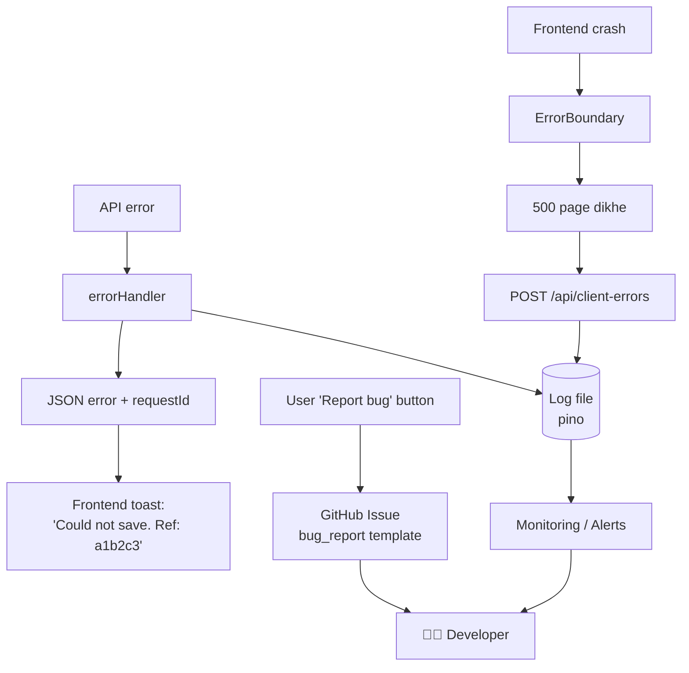

### 5.6 Bug tracking process

1. **Logs** — `pino` → `/var/log/morning-meeting/` (PM2 logrotate 14 din)
2. **Client errors** — `/api/client-errors` endpoint → same log
3. **(Optional) Sentry / GlitchTip** — errors ka dashboard + email alert.
   - GlitchTip ko **apne server par** chala sakte hain (data company ke andar rahega).
4. **GitHub Issues** — har bug ek issue, label: `bug`, `priority:high`, `area:qa`...
5. **Bug fix flow:** Issue → `fix/xyz` branch → PR (`Fixes #12`) → CI green → merge → auto deploy → issue auto close

`.github/ISSUE_TEMPLATE/bug_report.md`:

```markdown
---
name: 🐞 Bug report
labels: bug
---
**Kya hua?**
**Kya hona chahiye tha?**
**Steps to reproduce:** 1. … 2. … 3. …
**Screen / Page:**
**Device:** PC / Android / iPhone — Browser:
**Request ID (error message mein):**
**Screenshot:**
```

### ✅ Phase 5 Done jab:
- [ ] `https://.../kuchbhi` → 404 page
- [ ] `/api/kuchbhi` → JSON 404
- [ ] Jaan-bujh ke component crash karke check: 500 page + log entry
- [ ] Bug template GitHub par

---

## Phase 6 — Company Server Setup

**⏱ 2–3 din** (IT team ke saath) · **Goal:** App 24×7 HTTPS par chale, reboot ke baad khud start ho.

### 6.1 Server requirement

| Resource | Minimum | Recommended |
|---|---|---|
| OS | Ubuntu 22.04 LTS / Windows Server 2019 | **Ubuntu 24.04 LTS** |
| CPU | 2 core | 4 core |
| RAM | 4 GB | 8 GB (LibreOffice preview RAM khata hai) |
| Disk | 40 GB SSD | 100 GB SSD + alag backup disk |
| Network | Static IP | Static IP + internal DNS name |
| Internet (outbound) | GitHub, npm, SMTP tak | ✔ |

### 6.2 Deployment topology

```mermaid
flowchart TB
    subgraph LAN["🏭 Company Network"]
        PC[Office PCs]
        WIFI[📱 Phones on Wi-Fi]
        subgraph SRV["Server: meeting.company.local (e.g. 192.168.1.50)"]
            direction TB
            FW[Firewall: open sirf 80, 443 (+22 SSH IT ke liye)]
            NG[Nginx :443]
            PM[PM2 → Node app :5180<br/>127.0.0.1 only]
            DATA[(/var/lib/morning-meeting)]
            RUN[GitHub Runner service]
            FW --> NG --> PM --> DATA
        end
        NAS[(💾 NAS / Backup share)]
    end
    PC --> FW
    WIFI --> FW
    DATA -->|nightly| NAS
    RUN <-->|outbound HTTPS only| GH[(GitHub)]
```

### 6.3 ⚠️ HTTPS kyon zaroori hai

PWA install, Service Worker, Push Notifications — **ye sab browsers sirf HTTPS par allow karte hain**
(sirf `localhost` exception hai). Abhi phone par `http://192.168.x.x:5180` khulta hai, isliye mobile par
"Install app" aur notifications theek se kaam nahi karenge.

| Option | Kab use karein | Kaise |
|---|---|---|
| **A. Public domain + Cloudflare Tunnel** ✅ | Phone par office ke bahar bhi chahiye | `meeting.company.com` → Cloudflare Tunnel → server. Port kholna nahi padta, free SSL + CDN |
| **B. Public domain + Let's Encrypt** | Server ka public IP hai | `certbot --nginx` |
| **C. Internal CA certificate** | Sirf office ke andar, internet par expose nahi karna | IT ka company CA se cert; har phone par root cert install karna padega |

> Decision IT team ke saath lo (neeche checklist dekho). Office ke bahar access chahiye to **Option A** sabse safe aur aasaan hai.

### 6.4 Linux (Ubuntu) setup — step by step

```bash
# 1) System update + basic tools
sudo apt update && sudo apt upgrade -y
sudo apt install -y git curl nginx ufw build-essential

# 2) Node.js 24 LTS
curl -fsSL https://deb.nodesource.com/setup_24.x | sudo -E bash -
sudo apt install -y nodejs
node -v

# 3) LibreOffice (Word/PPT preview ke liye) — bina GUI
sudo apt install -y --no-install-recommends libreoffice-writer libreoffice-calc libreoffice-impress

# 4) Alag user (root se app nahi chalate)
sudo adduser --system --group --home /opt/morning-meeting mmapp
sudo mkdir -p /var/lib/morning-meeting/{data,backups} /var/log/morning-meeting
sudo chown -R mmapp:mmapp /opt/morning-meeting /var/lib/morning-meeting /var/log/morning-meeting

# 5) Firewall
sudo ufw allow OpenSSH
sudo ufw allow 'Nginx Full'
sudo ufw enable

# 6) PM2 (process manager — crash par restart, reboot par auto start)
sudo npm i -g pm2
sudo -u mmapp pm2 startup systemd   # jo command print ho, wo sudo se chalao

# 7) Code + .env
sudo -u mmapp git clone https://github.com/<org>/morning-meeting.git /opt/morning-meeting/app
sudo -u mmapp cp /opt/morning-meeting/app/.env.example /opt/morning-meeting/app/.env
sudo -u mmapp nano /opt/morning-meeting/app/.env   # values bharo
sudo chmod 600 /opt/morning-meeting/app/.env
```

### 6.5 PM2 config

```js
// infra/pm2/ecosystem.config.cjs
module.exports = {
  apps: [{
    name: 'morning-meeting',
    cwd: '/opt/morning-meeting/app',
    script: 'apps/api/src/server.mjs',
    instances: 1,               // SQLite + SSE ke liye 1 instance (cluster NAHI)
    exec_mode: 'fork',
    max_memory_restart: '1G',
    kill_timeout: 10000,        // graceful shutdown ka time
    env: { NODE_ENV: 'production' },
    out_file: '/var/log/morning-meeting/out.log',
    error_file: '/var/log/morning-meeting/error.log',
    time: true,
  }],
}
```

```bash
pm2 install pm2-logrotate                # logs rotate
pm2 set pm2-logrotate:retain 14
```

### 6.6 Nginx config

```nginx
# infra/nginx/morning-meeting.conf  →  /etc/nginx/sites-available/
server {
    listen 80;
    server_name meeting.company.com;
    return 301 https://$host$request_uri;
}

server {
    listen 443 ssl http2;
    server_name meeting.company.com;

    ssl_certificate     /etc/ssl/morning-meeting/fullchain.pem;
    ssl_certificate_key /etc/ssl/morning-meeting/privkey.pem;

    client_max_body_size 40m;           # Excel / photo upload

    # Security headers
    add_header Strict-Transport-Security "max-age=31536000" always;
    add_header X-Content-Type-Options nosniff always;
    add_header X-Frame-Options SAMEORIGIN always;
    add_header Referrer-Policy strict-origin-when-cross-origin always;

    gzip on;
    gzip_types text/css application/javascript application/json image/svg+xml;

    root /opt/morning-meeting/app/apps/web/dist;

    # Hashed assets (index-a1b2c3.js) — 1 saal cache, kabhi badalte nahi
    location /assets/ {
        expires 1y;
        add_header Cache-Control "public, max-age=31536000, immutable";
        try_files $uri =404;
    }

    # Service worker / manifest / index.html — kabhi cache nahi (naya version turant mile)
    location ~* ^/(sw\.js|registerSW\.js|manifest\.webmanifest|index\.html)$ {
        add_header Cache-Control "no-cache";
        try_files $uri =404;
    }

    # Server-Sent Events (live sync) — buffering band
    location /api/events {
        proxy_pass http://127.0.0.1:5180;
        proxy_http_version 1.1;
        proxy_set_header Connection '';
        proxy_buffering off;
        proxy_read_timeout 1h;
    }

    # API
    location /api/ {
        proxy_pass http://127.0.0.1:5180;
        proxy_http_version 1.1;
        proxy_set_header Host $host;
        proxy_set_header X-Real-IP $remote_addr;
        proxy_set_header X-Forwarded-For $proxy_add_x_forwarded_for;
        proxy_set_header X-Forwarded-Proto $scheme;
    }

    # React SPA — baaki sab index.html (404 page React dikhayega)
    location / {
        try_files $uri $uri/ /index.html;
    }
}
```

```bash
sudo ln -s /etc/nginx/sites-available/morning-meeting.conf /etc/nginx/sites-enabled/
sudo nginx -t && sudo systemctl reload nginx
```

### 6.7 Agar server **Windows Server** hai

| Linux wala | Windows equivalent |
|---|---|
| systemd + PM2 | **PM2** + `pm2-installer` (Windows service) **ya** **NSSM** se Node ko service banao |
| Nginx | **IIS + URL Rewrite + ARR** (reverse proxy) ya Nginx for Windows / **Caddy** (auto HTTPS) |
| cron | **Task Scheduler** |
| ufw | **Windows Defender Firewall** — 80/443 inbound allow |
| `/var/lib/morning-meeting` | `D:\MorningMeeting\data` |
| LibreOffice | Normal installer (`C:\Program Files\LibreOffice`) — code already isko dhoondhta hai ✔ |

### 6.8 Option B: Docker (agar IT Docker prefer kare)

```dockerfile
# infra/docker/Dockerfile
FROM node:24-bookworm-slim AS build
WORKDIR /app
COPY package*.json ./
COPY apps/web/package.json apps/web/
COPY apps/api/package.json apps/api/
RUN npm ci
COPY . .
RUN npm run build

FROM node:24-bookworm-slim
RUN apt-get update && apt-get install -y --no-install-recommends \
      libreoffice-writer libreoffice-calc libreoffice-impress \
    && rm -rf /var/lib/apt/lists/*
WORKDIR /app
ENV NODE_ENV=production MM_DATA_DIR=/data
COPY --from=build /app/package*.json ./
COPY --from=build /app/apps/api ./apps/api
COPY --from=build /app/apps/web/dist ./apps/web/dist
RUN npm ci --omit=dev -w apps/api
USER node
EXPOSE 5180
HEALTHCHECK CMD node -e "fetch('http://127.0.0.1:5180/api/health').then(r=>process.exit(r.ok?0:1)).catch(()=>process.exit(1))"
CMD ["node", "apps/api/src/server.mjs"]
```

```yaml
# infra/docker/docker-compose.yml
services:
  app:
    build: { context: ../.., dockerfile: infra/docker/Dockerfile }
    restart: unless-stopped
    env_file: ../../.env
    volumes:
      - /var/lib/morning-meeting/data:/data
    ports:
      - "127.0.0.1:5180:5180"
```

> Recommendation: **PM2 se shuru karo** (simple, kam cheezein seekhni padengi). Docker baad mein, agar IT chahe.

### ✅ Phase 6 Done jab:
- [ ] `https://meeting.company.com` PC aur phone dono par khulta hai (🔒 lock icon)
- [ ] Server reboot → app khud start
- [ ] Port 5180 bahar se band, sirf 443 khula

---

## Phase 7 — CDN & Caching

**⏱ 1 din** · **Goal:** Pages turant load hon, chahe plant ka Wi-Fi slow ho.

### 7.1 Caching layers

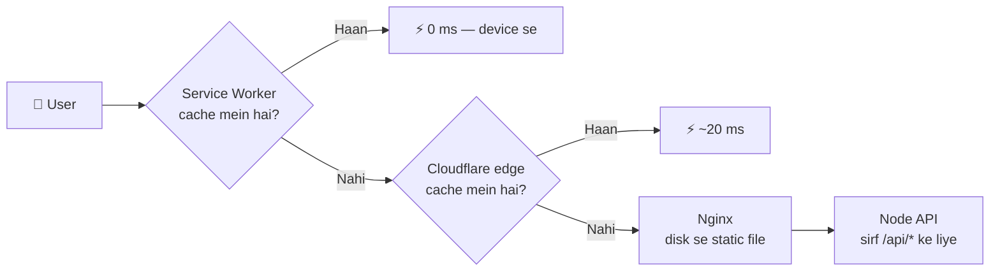

| Layer | Kya cache hota hai | Kitni der |
|---|---|---|
| **1. Service Worker (PWA)** | JS, CSS, HTML, icons, sample.xlsx | Naye build tak (already configured ✔) |
| **2. CDN (Cloudflare)** | `/assets/*` static files | 1 saal (hashed names) |
| **3. Nginx** | Static files disk se, gzip | `immutable` headers |
| **4. API** | ❌ cache NAHI (live data) | — gzip ✔ |

### 7.2 CDN — sahi expectation

- Agar app **sirf office LAN** par hai → public CDN ka fayda nahi (user aur server ek hi building mein hain).
  Tab "CDN" ka kaam **Nginx static caching + Service Worker** karega — ye kaafi hai.
- Agar app **internet par** (Option A — Cloudflare Tunnel) → Cloudflare free plan apne-aap CDN ban jaata hai:
  - Cloudflare Dashboard → Caching → **Cache Rules**: `/assets/*` → "Eligible for cache", Edge TTL 1 month
  - `/api/*` → **Bypass cache**
  - Speed → **Brotli ON**
  - SSL/TLS → **Full (strict)**
- Bade static files (`company.jpg`, `sample.xlsx`, sounds) ko compress / WebP mein convert karo.

### 7.3 Frontend bundle size kam karo

```ts
// Bade pages lazy load — pehli baar kam JS download ho
const QaPage = lazy(() => import('@/pages/QaPage'))
const CpkView = lazy(() => import('@/features/cpk/CpkView'))
```

- `xlsx` aur `recharts` bade libraries hain → sirf jis page par chahiye wahin load karo
- Check karne ke liye: `npx vite-bundle-visualizer`

### ✅ Phase 7 Done jab:
- [ ] Chrome DevTools → Lighthouse → Performance > 85
- [ ] `/assets/*` response mein `Cache-Control: immutable`
- [ ] Doosri baar app kholne par network se almost kuch download nahi hota

---

## Phase 8 — DevOps: Git, GitHub & CI/CD Auto-Deploy

**⏱ 2–3 din** · **Goal:** Code GitHub par push karo → test automatic → server par automatic deploy.

### 8.1 Git branching strategy

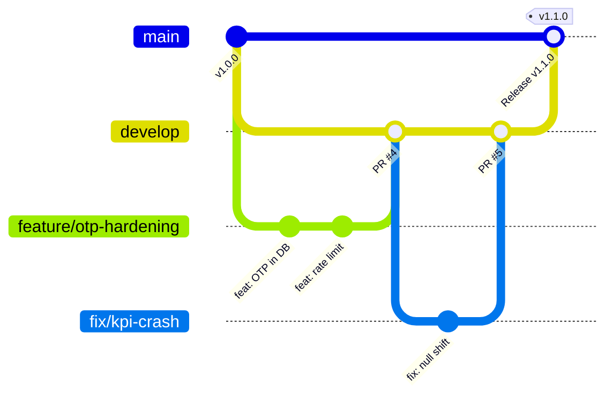

| Branch | Kaam | Deploy |
|---|---|---|
| `main` | Production code — hamesha stable | ✅ Auto → company server |
| `develop` | Agla release ready ho raha | (optional) staging |
| `feature/*` | Naya feature | ❌ |
| `fix/*` | Bug fix | ❌ |
| `hotfix/*` | Production ka urgent fix (main se) | ✅ merge par |

> Akele developer ho to simple rakho: `main` + `feature/*` / `fix/*` branches. `develop` jab team bade tab add karna.

### 8.2 GitHub repository setup

1. GitHub par **Private** repo: `morning-meeting` (company ki GitHub Organization ho to usme banao)
2. Laptop se pehla push:
   ```powershell
   git init
   git add .
   git commit -m "chore: initial structured project"
   git branch -M main
   git remote add origin https://github.com/<org>/morning-meeting.git
   git push -u origin main
   ```
3. **Settings → Branches → Branch protection** (`main`):
   - ✅ Require pull request before merging
   - ✅ Require status checks to pass (`CI`)
   - ✅ Block force pushes
4. **Settings → Environments → `production`**: secrets yahan (agar zaroorat ho), aur "Required reviewers" (deploy approval) optional.

### 8.3 CI/CD pipeline

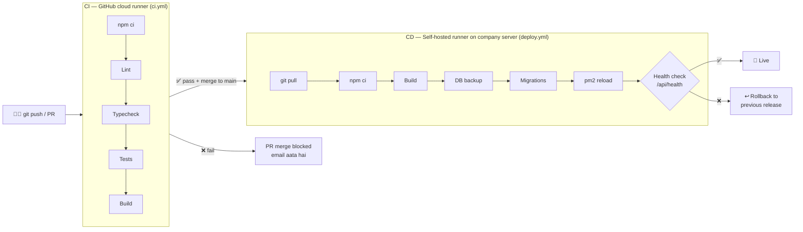

### 8.4 Self-hosted runner kyon?

Company server **firewall ke andar** hai — GitHub ka cloud usme SSH nahi kar sakta.
**Self-hosted runner** server par ek chhota program hai jo khud GitHub se **outbound** connect hota hai
aur jobs le leta hai. Isliye **koi inbound port kholne ki zaroorat nahi**. ✅ IT team ke liye bhi safe.

Setup: GitHub repo → **Settings → Actions → Runners → New self-hosted runner** → Linux/Windows choose karo →
jo commands dikhein, server par `mmapp` user se chalao → `sudo ./svc.sh install mmapp && sudo ./svc.sh start`.
Runner ko label do: `company-server`.

> 🔒 Self-hosted runner sirf **private** repo ke saath use karo (public repo mein koi bhi PR khol ke aapke server par code chala sakta hai).

### 8.5 `ci.yml`

```yaml
# .github/workflows/ci.yml
name: CI
on:
  pull_request:
  push:
    branches: [main]

concurrency:
  group: ci-${{ github.ref }}
  cancel-in-progress: true

jobs:
  build-and-test:
    runs-on: ubuntu-latest
    steps:
      - uses: actions/checkout@v4
      - uses: actions/setup-node@v4
        with:
          node-version-file: .nvmrc
          cache: npm
      - run: npm ci
      - run: npm run lint
      - run: npm run typecheck
      - run: npm test
      - run: npm run build
      - uses: actions/upload-artifact@v4
        with:
          name: web-dist
          path: apps/web/dist
          retention-days: 7
```

### 8.6 `deploy.yml`

```yaml
# .github/workflows/deploy.yml
name: Deploy
on:
  workflow_run:
    workflows: [CI]
    types: [completed]
    branches: [main]
  workflow_dispatch:            # GitHub se manual "Run workflow" button bhi

concurrency:
  group: deploy-production
  cancel-in-progress: false     # ek deploy chal raha ho to doosra wait kare

jobs:
  deploy:
    if: ${{ github.event_name == 'workflow_dispatch' || github.event.workflow_run.conclusion == 'success' }}
    runs-on: [self-hosted, company-server]
    environment: production
    steps:
      - name: Deploy
        run: /opt/morning-meeting/app/infra/scripts/deploy.sh ${{ github.event.workflow_run.head_sha || github.sha }}
```

### 8.7 `deploy.sh` (rollback ke saath)

```bash
#!/usr/bin/env bash
# infra/scripts/deploy.sh <commit-sha>
set -euo pipefail
SHA="${1:?commit sha required}"
APP=/opt/morning-meeting/app
BACKUPS=/var/lib/morning-meeting/backups/pre-deploy
cd "$APP"

PREV=$(git rev-parse HEAD)
echo "▶ Deploying $SHA (previous: $PREV)"

echo "▶ 1/6 DB backup"
mkdir -p "$BACKUPS"
npm run backup:sqlite -w apps/api -- "$BACKUPS"     # script output folder ko pehla argument leta hai
ls -1t "$BACKUPS" | tail -n +6 | xargs -r -I{} rm -rf "$BACKUPS/{}"  # last 5 rakho

echo "▶ 2/6 Fetch code"
git fetch --quiet origin
git checkout --quiet --force "$SHA"

echo "▶ 3/6 Install + build"
npm ci --no-audit --no-fund
npm run build

echo "▶ 4/6 Restart (migrations run on startup)"
pm2 reload infra/pm2/ecosystem.config.cjs --update-env

echo "▶ 5/6 Health check"
for i in {1..15}; do
  if curl -fsS http://127.0.0.1:5180/api/health >/dev/null; then
    echo "✅ Deploy successful: $SHA"; exit 0
  fi
  sleep 2
done

echo "❌ Health check failed — rolling back to $PREV"
git checkout --quiet --force "$PREV"
npm ci --no-audit --no-fund && npm run build
pm2 reload infra/pm2/ecosystem.config.cjs --update-env
exit 1
```

> Note: Agar kisi migration ne DB schema badla hai to code rollback ke saath DB bhi pre-deploy backup se
> restore karna pad sakta hai — isliye migrations hamesha **backward-compatible** likho (column add karo, delete mat karo).

### 8.8 Versioning & Releases

- **Semantic Versioning:** `MAJOR.MINOR.PATCH` → `1.4.2`
  - PATCH = bug fix, MINOR = naya feature, MAJOR = breaking change
- Release: `git tag v1.1.0 && git push --tags` → GitHub → Releases → "Generate release notes"
- `CHANGELOG.md` update karo
- App ke **About page** (`AboutApplicationPage.tsx`) mein version + commit dikhayo (Vite `define` se `__APP_VERSION__`)

### 8.9 Roz ka developer workflow

```
1. git checkout main && git pull
2. git checkout -b feature/monthly-export
3. ... code likho ...  npm run dev  se test
4. git add . && git commit -m "feat(monthly): add Excel export"
5. git push -u origin feature/monthly-export
6. GitHub par Pull Request kholo → CI green ✅ → review → Merge
7. ☕ 2–3 minute → server par automatically live
```

### ✅ Phase 8 Done jab:
- [ ] PR par CI automatic chalta hai
- [ ] `main` mein merge → server par auto deploy
- [ ] Jaan-bujh ke tooti hui build deploy karke rollback test kiya

---

## Phase 9 — Mobile App (PWA)

**⏱ 2 din** · **Goal:** Phone par app icon, full-screen, offline basic support, notifications.

### 9.1 Already ready ✔

- `vite-plugin-pwa` with manifest (name, icons 192/512/maskable, `display: standalone`)
- `autoUpdate` + `skipWaiting` + `clientsClaim` (naya version turant)
- `push-sw.js` notification handling
- `InstallButton.tsx`

### 9.2 Kya add / fix karna hai

| # | Kaam | Detail |
|---|---|---|
| 1 | **HTTPS** | Phase 6 — iske bina install/notifications nahi |
| 2 | `base: './'` → `'/'`, `start_url: '/'`, `scope: '/'` | Router ke saath sahi paths |
| 3 | `id: '/'` manifest mein | Browser app ko uniquely pehchane |
| 4 | **Offline fallback** | `workbox.navigateFallback: '/index.html'` + offline banner (`useOnlineStatus` hook) |
| 5 | **API runtime caching** | Dashboard data `NetworkFirst` (offline par last data dikhe) |
| 6 | **Update prompt** | "New version available — Reload" toast |
| 7 | **Screenshots** in manifest | Android par rich install dialog |
| 8 | **iOS** meta tags | `apple-mobile-web-app-capable`, status bar style, splash |
| 9 | **Shortcuts** | Long-press icon → "Upload Report", "QA" |

```ts
// vite.config.ts — PWA additions
VitePWA({
  registerType: 'autoUpdate',
  manifest: {
    id: '/',
    start_url: '/',
    scope: '/',
    // ...existing fields
    shortcuts: [
      { name: 'QA Dashboard', url: '/qa', icons: [{ src: 'icons/pwa-192x192.png', sizes: '192x192' }] },
    ],
    screenshots: [
      { src: 'screenshots/desktop.png', sizes: '1280x800', type: 'image/png', form_factor: 'wide' },
      { src: 'screenshots/mobile.png',  sizes: '750x1334', type: 'image/png' },
    ],
  },
  workbox: {
    navigateFallback: '/index.html',
    navigateFallbackDenylist: [/^\/api\//],
    runtimeCaching: [{
      urlPattern: ({ url }) => url.pathname.startsWith('/api/') && !url.pathname.startsWith('/api/auth'),
      handler: 'NetworkFirst',
      options: { cacheName: 'api', networkTimeoutSeconds: 5, expiration: { maxEntries: 50, maxAgeSeconds: 86400 } },
    }],
    // ...existing options
  },
})
```

### 9.3 Phone par install kaise hoga (users ke liye guide)

```
 ANDROID (Chrome)                         iPHONE (Safari)
 ┌─────────────────────────┐              ┌─────────────────────────┐
 │ 1. Chrome mein URL kholo│              │ 1. Safari mein URL kholo│
 │ 2. "Install app" banner │              │ 2. Share button  ⬆️      │
 │    ya ⋮ → Install app   │              │ 3. "Add to Home Screen" │
 │ 3. Home screen par icon │              │ 4. Add                  │
 │    📊 Morning Meeting    │              │ 5. Home screen par icon │
 └─────────────────────────┘              └─────────────────────────┘
```

> iPhone par push notifications iOS 16.4+ par, aur **sirf home screen se install** karne ke baad milte hain.

### 9.4 (Optional) Play Store / APK

PWA ko Android app (APK/AAB) mein wrap kar sakte hain — **Trusted Web Activity (TWA)**:
- **PWABuilder.com** par URL daalo → "Package for Android" → APK download
- Domain verify karne ke liye `/.well-known/assetlinks.json` server par rakhna padta hai
- Company ke andar MDM / direct APK share se distribute kar sakte ho

### ✅ Phase 9 Done jab:
- [ ] Lighthouse → PWA "Installable" ✅
- [ ] Android + iPhone dono par install hua
- [ ] Airplane mode mein app khulta hai (last data / offline message)
- [ ] Naya deploy → phone par "update" mil jaata hai

---

## Phase 10 — Monitoring, Backups & Go-Live

**⏱ 1–2 din**

### 10.1 Monitoring

| Tool | Kya karta hai | Setup |
|---|---|---|
| `/api/health` (already hai ✔) | DB + app status | Isme DB ping, disk free, version add karo |
| **Uptime Kuma** (self-hosted, free) | Har 1 min health check, down hone par email/Telegram/WhatsApp alert | Docker se ek command |
| `pm2 monit` / `pm2 logs` | Live CPU, RAM, logs | Built-in |
| Disk alert | Disk 80% full → email | cron script / Uptime Kuma |

### 10.2 Documentation (docs/ folder)

| File | Kiske liye | Content |
|---|---|---|
| `README.md` | Har koi | Overview, quick start |
| `docs/ARCHITECTURE.md` | Developers | Is plan ke diagrams |
| `docs/DEPLOYMENT.md` | Dev / IT | Phase 6 + 8 ke steps |
| `docs/RUNBOOK.md` | IT / On-call | "App down → ye karo", restore backup, restart |
| `docs/API.md` | Developers | Endpoints, request/response |
| `docs/USER-GUIDE.md` | End users | Login, upload, install app |

**RUNBOOK example:**

| Problem | Check | Fix |
|---|---|---|
| Site nahi khul rahi | `pm2 status`, `systemctl status nginx` | `pm2 restart morning-meeting` |
| 502 Bad Gateway | Node app band | `pm2 logs --lines 100` dekho |
| OTP email nahi aa raha | `logs` mein SMTP error | `.env` SMTP password / App password check |
| Disk full | `df -h` | Old backups / logs saaf karo |
| Galat deploy ho gaya | GitHub Actions log | Actions → Deploy → pichhla successful run "Re-run" |
| Data kharab | — | `npm run restore:sqlite` pre-deploy / nightly backup se |

### 10.3 Go-Live Checklist

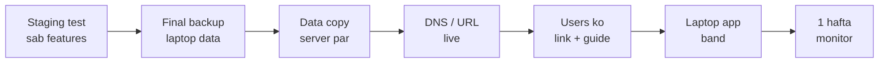

- [ ] Saare features server par test (upload Excel, KPI, QA, notes, notifications, admin)
- [ ] Laptop ka final backup → server par restore → data count match
- [ ] HTTPS ✅, PWA install ✅ (Android + iPhone)
- [ ] OTP email real inbox mein aa raha (spam mein nahi)
- [ ] Admin account ka Authenticator naye URL ke saath kaam kar raha
- [ ] Backup cron chal raha + restore test ✅
- [ ] Uptime alert test (app band karke dekho alert aaya?)
- [ ] Users ko URL + `USER-GUIDE.md` bhejo
- [ ] Laptop wala `npm run serve` band karo (do jagah data na bane)

---

## 📅 Timeline

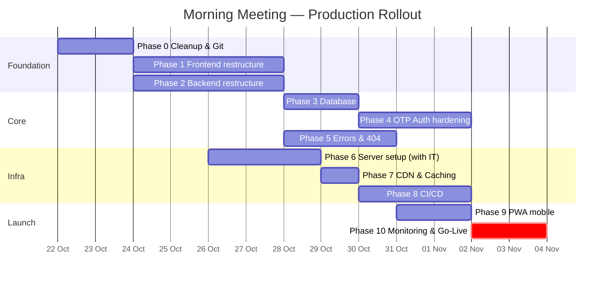

> Phase 6 (server) IT team ke saath **parallel** chal sakta hai jab tak aap Phase 1–2 kar rahe ho.
> Total: **~3–4 hafte** (ek developer, part-time maintenance ke saath).

---

## ❓ IT Team se kya poochna hai (Checklist)

Server setup se **pehle** ye answers chahiye:

| # | Sawaal | Kyon |
|---|---|---|
| 1 | Server ka **OS** kya hai? (Ubuntu / Windows Server / VM?) | Phase 6 ka path decide hoga |
| 2 | CPU / RAM / Disk kitna milega? | Section 6.1 dekho |
| 3 | **Static IP** aur internal DNS name mil sakta hai? (`meeting.company.local`) | Fixed URL |
| 4 | App **sirf office ke andar** chahiye ya **bahar se bhi** (phone, ghar se)? | HTTPS / CDN option (6.3) |
| 5 | Company ka **domain** hai? Subdomain (`meeting.company.com`) bana sakte hain? | HTTPS certificate |
| 6 | Server se **outbound internet** (github.com, npmjs.org, smtp) allowed hai? | CI/CD runner + npm + email |
| 7 | **Company SMTP** / Microsoft 365 mail credentials milenge? (`no-reply@...`) | OTP emails |
| 8 | Server par **SSH / Remote Desktop** access kisko milega? | Maintenance |
| 9 | **Backup** kahan rakh sakte hain? (NAS / network share / 2nd disk) | Phase 3 |
| 10 | **Antivirus / proxy** koi Node/npm ko block to nahi karega? | Install issues |
| 11 | Docker allowed hai? | Option B |
| 12 | Company GitHub Organization hai? | Repo kahan banana hai |

---

## ✅ Master Checklist

### Phase 0 — Cleanup
- [ ] Git install + config
- [ ] Faltu files + company data hataya
- [ ] `.gitignore`, `.env.example`, `.editorconfig`, `.nvmrc`, ESLint, Prettier
- [ ] Naya README

### Phase 1 — Frontend
- [ ] `apps/web` monorepo structure
- [ ] `features/` folders
- [ ] `@/` path alias
- [ ] React Router + ProtectedRoute
- [ ] `services/api.ts`

### Phase 2 — Backend
- [ ] `apps/api` structure, `index.mjs` split
- [ ] `config/env.mjs` validation
- [ ] pino logging
- [ ] helmet, graceful shutdown, listen on 127.0.0.1

### Phase 3 — Database
- [ ] Data `/var/lib/morning-meeting`
- [ ] Migration system
- [ ] Nightly backup + restore test

### Phase 4 — Auth
- [ ] `crypto.randomInt` OTP
- [ ] OTP table (hashed) + attempts
- [ ] `devOtp` production mein band
- [ ] Rate limiting + resend cooldown
- [ ] Company SMTP

### Phase 5 — Errors
- [ ] 404 / 403 / 500 / Offline pages
- [ ] ErrorBoundary + client error logging
- [ ] API 404 JSON + central error handler
- [ ] GitHub issue templates

### Phase 6 — Server
- [ ] OS + Node 24 + Nginx + LibreOffice
- [ ] HTTPS
- [ ] PM2 auto-start
- [ ] Firewall

### Phase 7 — CDN
- [ ] Nginx cache headers
- [ ] (Optional) Cloudflare
- [ ] Lazy loading

### Phase 8 — CI/CD
- [ ] Private GitHub repo + branch protection
- [ ] `ci.yml`
- [ ] Self-hosted runner
- [ ] `deploy.yml` + `deploy.sh` with rollback

### Phase 9 — PWA
- [ ] HTTPS install test (Android + iOS)
- [ ] Offline fallback + API cache
- [ ] Update prompt
- [ ] (Optional) TWA APK

### Phase 10 — Go-Live
- [ ] Uptime Kuma alerts
- [ ] docs/ complete (RUNBOOK, DEPLOYMENT, USER-GUIDE)
- [ ] Data migration laptop → server
- [ ] Users ko link + guide

---

> 💬 **Next step:** IT team ke saath "Sawaal" wali list discuss karo, aur saath-saath **Phase 0** shuru karo.
> Kisi bhi phase ka code implement karna ho to bolo — main step-by-step kar dunga.
